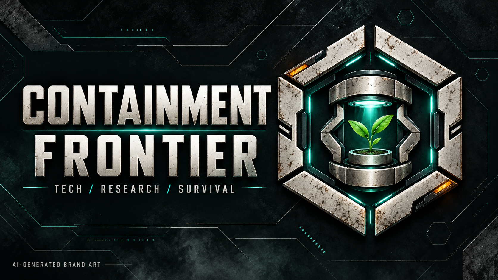
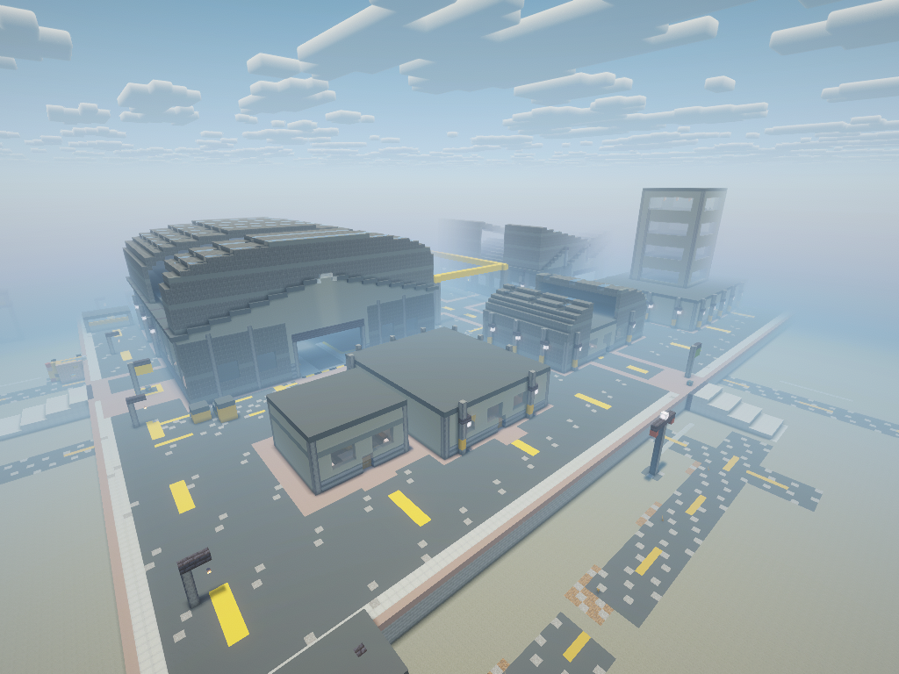
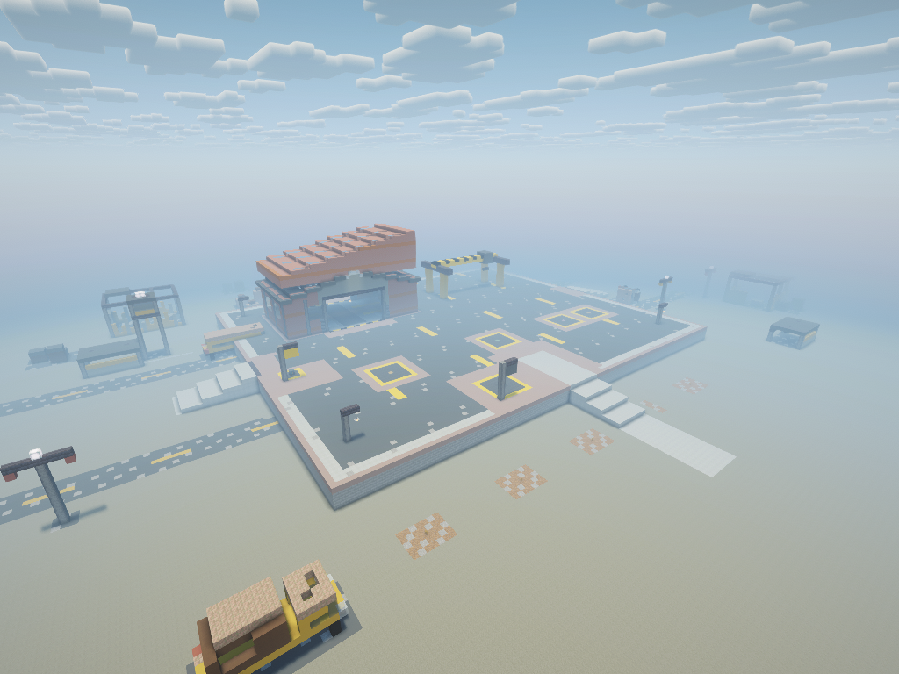
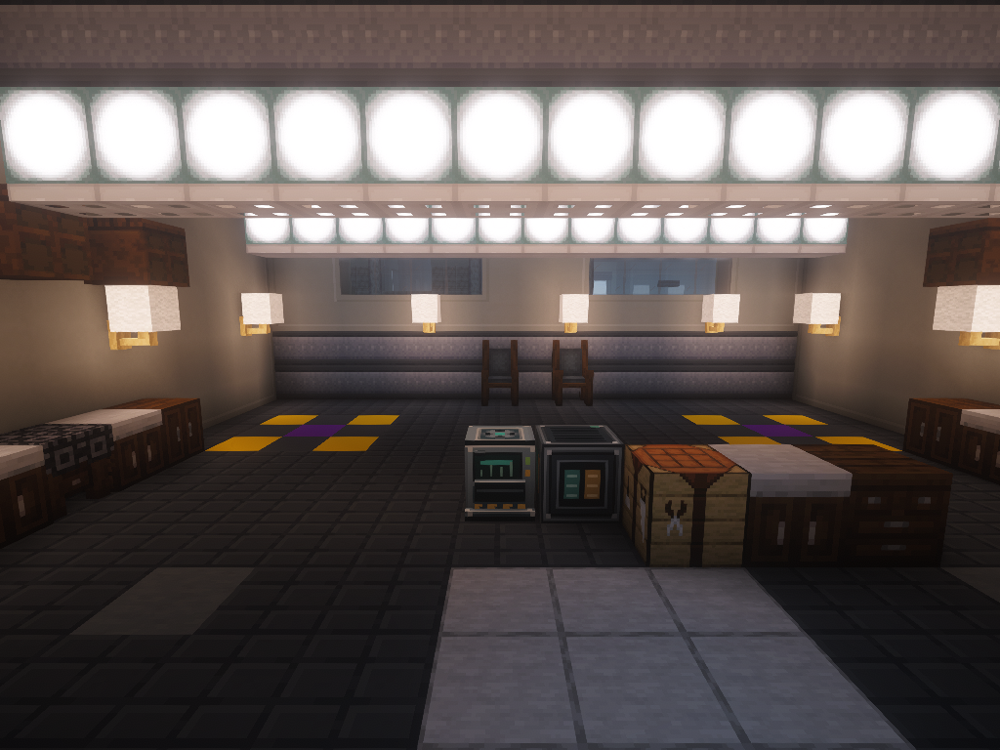

# Containment Frontier

Published by **[GTRowsss](https://github.com/GTRows)**. Minecraft 1.21.1 / NeoForge 21.1.265 / Java 21.

**[Download the beta](https://github.com/GTRows/containment-frontier/releases/tag/v0.5.0-beta.2)** · [Installation](INSTALLATION.md) · [Report an issue](https://github.com/GTRows/containment-frontier/issues)

Rebuild the industry. Hold the perimeter. Research the recovery.

The outbreak left a fractured industrial landscape and a damaged scientific outpost. You are the researchers who stayed behind. Recover working territory, reconnect its infrastructure and turn a fragile refuge into an automated production network capable of supporting a cure.

This is an expert-oriented technology and quest campaign on a purpose-built world. Play solo or share one campaign with an FTB Teams party. Progress comes from engineered production, regional control and research rather than a list of zombie kill counts.

## Build a system that can survive

- **A connected technology campaign:** 14 chapters and 638 quests, with manufactured intermediates connecting machines and later production tiers. Select Normal or Expert recipes and one of 10 campaign difficulty levels at the start.
- **Recover seven regions:** different industrial districts have their own commissioning conditions, resource access and local production benefits. Three faction sites connect trade and analysis to the recovery effort.
- **Automate your defense:** build production for ammunition, power and tiered equipment. Night assaults challenge controlled territory; stronger defenses depend on your industrial progress.
- **Extract and reconnect:** develop tiered extraction and upgrade its capability. Paid bridge projects establish protected physical logistics routes between controlled areas.
- **Research with real equipment:** Materials, Energy, Defense and Biology use prototypes, samples, measurements and shared methods. Medicinal crop genetics contribute to treatment production rather than replacing mining with ore plants.
- **Make survival an engineering problem:** technical nutrition and paid personal clones replace cooking chains and free respawns. Every registered participant needs their own ready clone. If any participant dies without one, the shared campaign fails, including for teammates who still have reserves. Recovery then requires an explicit operator restore or a new campaign.
- **Finish through production:** build toward singularities and integrated scientific manufacturing across the technology network.

## Technology in the campaign

Mekanism, Immersive Engineering, Industrial Foregoing, Ender IO, Actually Additions, PneumaticCraft: Repressurized, Oritech and Draconic Evolution form the machinery backbone. Refined Storage, Simple Storage Network, Flux Networks, RFTools, Solar Flux Reborn and Extreme Reactors support the factory, with additional tools and planning helpers.

No EMC, Create, Applied Energistics 2, Tinkers' Construct or magic progression. This campaign emphasizes automation, firearms and engineered defenses over sword combat or extended exploration.

## Starting a game

Download the beta ZIP from this repository's Releases and import it into a new CurseForge App profile. This is a GitHub-distributed beta; the CurseForge catalog listing is pending. Open the supplied `continuity_frontier_v1` world, or create a fresh **Survival** world using the pack's campaign preset. Leave Minecraft's own **Hardcore** toggle off: the campaign implements personal, finite clone lives itself.

Choose the recipe mode and difficulty once. Use your starting **Field Tablet** to open **Crew registration**, create or join an FTB Teams party, then select **Register campaign**. A one-player party is sufficient. Follow the opening quest chapter for supplies and production; there is no free clone station or prepared clone body.

The tablet and inventory/JEI shortcuts open Operations and Research. Local machine panels handle that machine's requirements and connection faces. Pack-owned interface, quest and story text support **English, Russian, Spanish, Brazilian Portuguese, German and Turkish** in beta 2 and later. Open **Language** in the Operations sidebar to enter **Settings**. Your choice applies immediately and is saved for that client profile; it does not change Minecraft's overall language. Item and block names remain English. Beta 1 retains its original English/Turkish support.

## Version and server information

- Minecraft **1.21.1**, **NeoForge 21.1.265**, **Java 21**.
- Reference test profile: **6 GB Java heap**. This is a tested configuration, not a guaranteed minimum; graphics and shader performance depend on the computer.
- A matching Docker server package exists in development. Its public binary distribution review is pending, so this GitHub beta provides the client pack only.
- Automatic world backups are configured through **Simple Backups**. Keep independent copies and the matching pack version before updating; a local backup is not a substitute for off-machine storage.

## Public beta scope

Beta 2 extends the private59 a9 campaign with the language settings update. Its App-generated manifest is unchanged. The original campaign module is included in overrides while its CurseForge catalog approval is pending. Automated source checks, scoped native machine/research/defense fixtures, personal-clone rules, owned models and JEI visibility, basic client interfaces and backup/restore have recorded checks. They do not constitute a full survival playthrough. The language update passes source and resource checks; the new Settings view still needs an in-game visual and keyboard check. Earlier native checks retain their original build scope.

Long solo/cooperative campaigns, naturally earned high-trait crop breeding and sustained endgame treatment production still need broader playtesting. Balance and progression may change during beta. Start a new world for this first beta and do not overwrite an existing campaign.

## Credits and artwork disclosure

**Faithful 32x** by the Faithful Resource Pack team is selected by default: [faithfulpack.net](https://faithfulpack.net/) · [license](https://faithfulpack.net/license).

**Complementary Reimagined** by EminGT is enabled by default through Iris: [complementary.dev](https://www.complementary.dev/) · [license](https://www.curseforge.com/minecraft/shaders/complementary-reimagined/license). The pack author handles integration support. Both visual packs remain unmodified platform dependencies.

All included mods belong to their respective authors; see the dependency list for individual projects. The bundled **Continuity Frontier** campaign module is original pack-specific content and requires the matching pack data.

Generative AI assisted the custom campaign implementation, writing, localization and release preparation. The project icon and header are **AI-generated brand artwork**, not screenshots or promises of in-game models. Only images explicitly labeled as native captures show the actual game. Please use this repository's Issues for beta feedback; include the pack version and reproduction steps, and remove credentials and personal information from logs.

## Native in-game gallery

These unedited F2 screenshots show a fresh authored-world copy with the pinned visuals. Creative setup and a spectator camera were used; they are appearance references, not earned survival progression.

## Repository scope

This repository distributes the pack, documentation and original presentation assets. The internal development source and history are maintained separately. Original content remains All Rights Reserved; dependency licenses and credits remain applicable.
